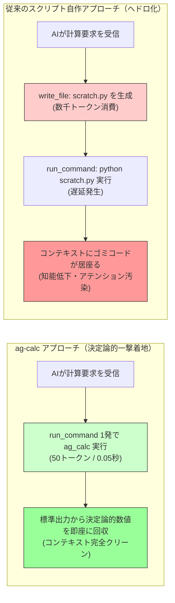

# AG Scientific Co-Processor (`ag-calc`) - User Guide

> **「AIにスクリプトを書かせるな。使い捨てコードの山でアテンションを窒息させる前に、決定論的な計算エンジンを与えよ。」**

このドキュメントは、エージェント用スキル [./SKILL.md](./SKILL.md) および決定論的数理CLI [./scripts/ag_calc.py](./scripts/ag_calc.py) の背景思想と活用法を解説したものです。

---

## 1. 開発の背景：「AIにコードを書かせればいい」という幻想

多くのエンジニアや開発者は、AIエージェントに計算をさせようとするとき、こう考えます：

> 「AIはPythonが書けるし、サンドボックス（Code Interpreter）もある。わざわざ専用の電卓CLIを用意しなくても、AI自身にスクリプトを書かせて実行（`write_file` ➔ `python scratch.py`）させればいいのではないか？」

一見合理的に思えるこのアプローチは、**AIエージェントを本気で日常運用・長時間自律稼働させた瞬間に、深刻なボトルネックとなって崩壊します。**
言われてみれば「コロンブスの卵」のような極めてシンプルな問題ですが、現場で大量のトークンを燃やした者にしか見えない落とし穴が存在します。

### 現場で直面する4つの病理

1. **トークン消費の爆発（95%の浪費）**:
   たった1回の掛け算や画角計算のために、AIはファイル生成ツールを呼び出し、Pythonコードを記述し、実行コマンドを発行し、出力をパースし、後片付け（`rm`）を行います。1回の計算で **1,500〜2,000トークン** を平気で燃焼します。
2. **コンテキストのヘドロ化（知能低下の主因）**:
   `import math; def solve(): ...` という使い捨てのゴミコードが会話履歴（コンテキストウィンドウ）に永続化されます。アテンションがゴミに吸われ、エージェントの後続タスクの推論品質（IQ）が急速に劣化します。
3. **思考テンポの崩壊（レイテンシ）**:
   「ファイル生成 ➔ コマンド実行 ➔ 削除」の多段往復により、数十秒の遅延が発生し、エージェントの思考ループが途切れます。
4. **構文トラップと桁の幻覚（AIあるある）**:
   数式内の `^` をPythonのビットXORと誤認する、全角記号（`×` `÷`）でSyntaxErrorを起こす、`10k` や `2.2u` を手動展開してゼロの数を間違える、といった確率的トークン予測特有のミスが多発します。

---

## 2. 視覚的比較：スクリプト自作 vs 決定論的コプロセッサ



### スペック比較表

| 項目 | スクリプト自作（従来） | `ag-calc` | 改善効果 |
| :--- | :--- | :--- | :--- |
| **トークン消費** | 1,500 〜 2,000 tokens | **50 〜 80 tokens** | **約95%削減** |
| **実行ターン数** | 2 〜 3 往復 | **1 往復（一撃）** | **最速着地** |
| **コンテキスト汚染** | ゴミコードが永続化 | **完全ゼロ（クリーン）** | **知能維持** |
| **外部依存性** | 不安定な使い捨て環境 | **Python標準ライブラリのみ** | **Zero-Dependency** |

---

## 3. コア機能とエンジニアリング仕様

`ag-calc` は、確率的言語モデル（LLM）の弱点である**「決定論的な計算能力（厳密な数理・幾何・空間把握）」**を補完するため、実戦で必要なモジュールを1本のスクリプトに凝縮しています。

### 1. 数理・エンジニアリング演算 (`math`)
- **安全なAST評価**: `eval()` ではなく Python の `ast`（抽象構文木）で安全に数式をパース。
- **SI接頭辞の自動解釈**: `10k`, `2.2u`, `100M`, `4.7p` などを直感的に記述可能。
- **電気工学・特殊演算**: 並列合成抵抗 `parallel(100, 200, 300)` や $n$ 乗根 `root(125, 3)`、三角関数（`deg`/`rad`）。
- **ポカヨケ（自動正規化）**: 全角記号（`×` `÷` `＋` `－`）や `^`（べき乗）を自動変換。

### 2. 状態保持と変数チェーン (`mem`)
- **直前結果の再利用**: `ans` 変数により、電卓のように直前の計算結果を引き継ぎ可能。
- **変数の永続化**: `r = 10k` のように代入すると、プロセスが終了してもローカルステートファイル（`.ag_calc_state.json`）に変数が保持され、次回コマンドで呼び出せます。

### 3. Active Vision & 幾何計算 (`vision`)
- **PTZカメラ画角・首振りオフセット**: 画角（FoV）と解像度、ターゲットのピクセル位置から、カメラを何度動かすべきか（Pan/Tilt offset）を即時算出。
- **Bounding Box 座標変換**: 正規化座標（0.0〜1.0）と絶対ピクセル座標の相互変換。

### 4. テキスト・時間指標 (`text`, `time`)
- **X (Twitter) 280pt厳格判定**: CJK文字（2pt）、ASCII（1pt）、URL（23pt固定）の重み付けを公式API基準で決定論的に算出。
- **時間差分・エポック秒**: 「特定日付から現在まで何日何時間経過したか」やエポック秒の相互変換を標準化。

---

## 4. 導入方法 (How to Install)

### Antigravity IDE の場合
1. 本フォルダ（`ag-calc`）をワークスペースの `.agents/skills/ag-calc` に配置します。
2. エージェントは起動時に自動的に `SKILL.md` を検知し、以降の計算タスクで自律的にスクリプトを呼び出します。

### Claude Code / Cursor / Cline 等の場合
1. `scripts/ag_calc.py` をプロジェクト内またはパスの通ったディレクトリに配置します。
2. システムプロンプトやカスタム指示に以下を追記してください：
   > 「計算や単位換算を行う際は、スクリプトを自作せず `python path/to/ag_calc.py math "数式"` を実行せよ。」

---

## 5. チートシート

```bash
# 困ったらヘルプ（実例一覧が出力されます）
python scripts/ag_calc.py

# 基本数理・SI単位
python scripts/ag_calc.py math "560k * 34.5u"
python scripts/ag_calc.py math "1 / (2 * π * 10k * 0.1u)"
python scripts/ag_calc.py math "parallel(100, 200, 300)"
python scripts/ag_calc.py math "root(125, 3)"

# 変数代入とチェーン
python scripts/ag_calc.py math "r1 = 10k"
python scripts/ag_calc.py math "r2 = 20k"
python scripts/ag_calc.py math "parallel(r1, r2)"

# 統計
python scripts/ag_calc.py math --stat "[12, 15, 18, 22, 30]"

# 日付差分
python scripts/ag_calc.py time diff "2026-01-01" "now"
```

---
*License: Meme-ware / Copyleft. AIの知能を無駄なトークン消費から解放するためにご自由にお使いください。*

