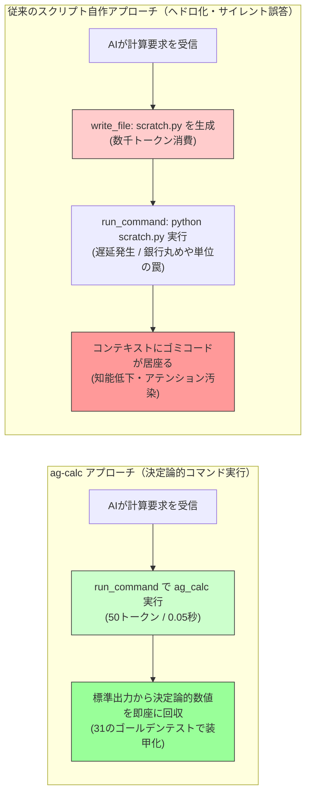

# AG Scientific Co-Processor (`ag-calc`) - User Guide

> **「AIにスクリプトを書かせるな。使い捨てコードの山でアテンションを窒息させる前に、決定論的な計算エンジンを与えよ。」**

このドキュメントは、エージェント用スキル [./SKILL.md](./SKILL.md) および決定論的数理CLI [./scripts/ag_calc.py](./scripts/ag_calc.py) の背景思想と活用法を解説したものです。

---

## 1. 開発の背景：「AIにコードを書かせればいい」という幻想

多くのエンジニアや開発者は、AIエージェントに計算をさせようとするとき、こう考えます：

> 「AIはPythonが書けるし、サンドボックス（Code Interpreter）もある。わざわざ専用の電卓CLIを用意しなくても、AI自身にスクリプトを書かせて実行（`write_file` ➔ `python scratch.py`）させればいいのではないか？」

一見合理的に思えるこのアプローチは、**AIエージェントを本気で日常運用・長時間自律稼働させた瞬間に、深刻なボトルネックとなって崩壊します。**
言われてみれば「コロンブスの卵」のような極めてシンプルな問題ですが、現場で大量のトークンを燃やした者にしか見えない落とし穴が存在します。

### 現場で直面する4つの病理

1. **トークン消費の爆発（95%の浪費）**:
   たった1回の掛け算や画角計算のために、AIはファイル生成ツールを呼び出し、Pythonコードを記述し、実行コマンドを発行し、出力をパースし、後片付け（`rm`）を行います。1回の計算で **1,500〜2,000トークン** を平気で燃焼します。
2. **コンテキストのヘドロ化（知能低下の主因）**:
   `import math; def solve(): ...` という使い捨てのゴミコードが会話履歴（コンテキストウィンドウ）に永続化されます。アテンションがゴミに吸われ、エージェントの後続タスクの推論品質（IQ）が急速に劣化します。
3. **思考テンポの崩壊（レイテンシ）**:
   「ファイル生成 ➔ コマンド実行 ➔ 削除」の多段往復により、数十秒の遅延が発生し、エージェントの思考ループが途切れます。
4. **構文トラップとサイレント誤答（最大の毒）**:
   数式内の `^` をPythonのビットXORと誤認する、全角記号（`×` `÷` `µ`）でSyntaxErrorを起こす、上付き文字（`5²`）が誤って `52` に化ける、Python標準の `round()` が偶数丸め（銀行丸め：`round(2.5)=2`）で黙って1ズレる……といった確率的トークン予測と使い捨てコード特有のミスが多発します。

---

## 2. 視覚的比較：スクリプト自作 vs 決定論的コプロセッサ



### スペック比較表

| 項目 | スクリプト自作（従来） | `ag-calc` | 改善効果 |
| :--- | :--- | :--- | :--- |
| **トークン消費** | 1,500 〜 2,000 tokens | **50 〜 80 tokens** | **約95%削減** |
| **実行ターン数** | 2 〜 3 往復 | **1 往復（直接回収）** | **最速着地** |
| **コンテキスト汚染** | ゴミコードが永続化 | **完全ゼロ（クリーン）** | **知能維持** |
| **計算の信頼性** | 使い捨てコードによる無監査 | **31件のゴールデンテスト保証** | **代表的サイレント誤答の抑止** |
| **外部依存性** | 不安定な使い捨て環境 | **Python標準ライブラリのみ** | **Zero-Dependency** |

---

## 3. コア機能とエンジニアリング仕様

`ag-calc` は、確率的言語モデル（LLM）の弱点である**「決定論的な計算能力（厳密な数理・幾何・空間把握）」**を補完するため、実戦で必要なモジュールを1本のスクリプトに凝縮しています。

### 1. 数理・エンジニアリング演算 (`math`)
- **安全なAST評価**: `eval()` ではなく Python の `ast`（抽象構文木）で安全にパース。文字列演算や巨大指数（$9^{9^9}$）の暴走を未然に遮断。
- **真の算術四捨五入 (`ROUND_HALF_UP`)**: Python標準の銀行丸め（`round(2.5)=2`）を排し、人間やLLMが直感的に期待する四捨五入（`round(2.5)=3`, `round(1234, -2)=1200`）を決定論的に保証。
- **SI接頭辞・工学単位の自動展開**: `10k`, `2.2u`, `100M`, `4.7p`, `10ms`, `50us` などを直感的に記述可能。`4.7µF * 1kΩ` や `10V / 2A` のように単位が付いたまま投げても自動展開。
- **工学・日常で多用される基本数学関数**: 並列合成抵抗 `parallel(100, 200, 300)`、実数奇数乗根対応の $n$ 乗根 `root(-8, 3)`、三角関数（`deg`/`rad`）、`hypot`, `gcd`, `lcm`, `min`, `max`, `clamp`, `factorial`, `comb`, `perm`。
- **検算モード (`--explain`)**: SI単位展開後の数式や ans 変数の使用状況、自動剥離された単位を JSON で可視化。

### 2. 状態保持と変数チェーン (`mem`)
- **直前結果の再利用**: `ans` 変数により、電卓のように直前の計算結果を引き継ぎ可能。
- **変数の永続化**: `r = 10k` のように代入すると、プロセスが終了してもローカルステートファイル（`.ag_calc_state.json`）に変数がアトミックに保持され、次回コマンドで呼び出せます（定数 `pi`, `e` への上書きは保護）。

### 3. Active Vision & 幾何計算 (`vision`)
- **PTZカメラ画角・首振りオフセット**: 画角（FoV）と解像度、ターゲットのピクセル位置から、カメラを何度動かすべきか（Pan/Tilt offset）を中心窩モデルで算出。
- **Bounding Box 座標変換**: 正規化座標（0.0〜1.0）および Gemini 形式の 0〜1000 グリッド座標（`--scale 1000`）と、絶対ピクセル座標の相互変換。

### 4. テキスト・時間指標 (`text`, `time`)
- **X (Twitter) 280ptカウント (twitter-text 仕様ベース・実用近似)**:
  - NFC正規化・異体字セレクタ付き絵文字・ZWJ連結絵文字（`❤️`, `👨‍👩‍👧‍👦`等）を2ptとして正確に集計。
  - 248の実在ccTLD（`.md`, `.py`, `.sh`等）の自動リンク化（23pt）を検知し、ファイル名の場合はポカヨケ警告（`url_warnings`）を出力。
  - `Node.js` や `config.json`、`http://localhost:8000` を誤ってURL判定しない高精度フィルター。
  - ※ 外部依存ゼロ（標準ライブラリのみ）で実装しているため、IDN等の特殊なホスト名など一部の極端なエッジケースは未網羅ですが、日常的なドラフト検証には十分な精度を担保しています。
- **時間差分・エポック秒**: ISO 8601対応。特定日時から現在までの経過日数・時間を人間可読形式で算出。

### 5. エラーテレメトリ (`.ag_calc_errors.log`)
- エージェントが構文ミスや引数ミスでコケた際、コマンド履歴とエラー内容をローカルログに自動アペンド（ドラフト本文はマスキング）。エージェントの利用傾向を後から分析可能。

---

## 4. 導入方法 (How to Install)

本ツールはエージェント用スキル標準に準拠した構成をとっており、各種AIコーディング環境や自律エージェント基盤で同様に活用できます。

### 1. スキルフォルダへの配置
お使いのエージェント環境（Antigravity IDE、Claude Code、Cursor等の各種エージェント基盤）のスキル管理ディレクトリに本フォルダ（`ag-calc`）を配置します。

- **一般的なエージェント環境（Antigravity等）**:
  ワークスペース配下の `.agents/skills/ag-calc` にフォルダごと配置します。
- **その他のエージェント・アシスタント基盤**:
  各ツールの仕様に応じたスキル配置ディレクトリ（例: `.claude/skills/` やカスタムツールの置き場）に配置してください。

エージェントは起動時やタスク開始時に `SKILL.md` の指示を自動検知し、数理計算や文字数判定タスクで自律的にスクリプトを呼び出すようになります。

### 2. 単体CLIとしての利用
Python 3.10以上が動作する環境であれば、外部パッケージのインストール不要（Zero-Dependency）で、ターミナルから直接スタンドアロンの関数電卓としても呼び出せます。

```bash
python scripts/ag_calc.py math "parallel(100, 200)"
python scripts/ag_calc.py text x "投稿ドラフト本文"
```

---


## 5. 既知の仕様・設計上のトレードオフ (Known Limitations)

`ag-calc` は、環境を選ばずに1秒で動作する「Zero-Dependency（Python標準ライブラリのみ）」を最優先として設計されています。そのため、サードパーティ製の大規模ライブラリを意図的に導入しておらず、以下の既知の仕様・境界条件が存在します。

1. **X (Twitter) 文字数判定における国際化ドメイン (IDN)**:
   - 公式の判定ライブラリ（npm/gem の `twitter-text`）を外部依存として抱え込まないため、URL判定を標準の正規表現と実在ccTLDリスト（248件）で再実装しています。
   - 一般的なASCIIホスト名や主要gTLD/ccTLDは高精度に判定しますが、キリル文字や日本語などの国際化ドメイン名（IDN / Punycode）のURL抽出・23pt加算は未網羅です。
2. **浮動小数点演算と極端な数式**:
   - 任意精度計算ライブラリ（`mpmath`）や記号計算ライブラリ（`sympy`）を使用せず、Python標準の `math`（IEEE 754 倍精度浮動小数点）で評価します。
   - そのため、極小の丸め誤差や桁落ちは標準Pythonと同様に発生し得ます。また、LLMの暴走・サービス不能を防ぐ安全設計として、階乗・順列・組み合わせ（`factorial`, `comb`, `perm`）には $n \le 1000$ の上限を設けています。
3. **千区切りカンマの非許容**:
   - `parallel(100, 200)` や `atan2(1, 2)` のような関数引数のカンマ区切りとの誤爆を防ぐため、数値内の千区切りカンマ（例: `1,000`）は構文エラーとしています。`max(1, 500)` のような記述は「1 と 500 の2引数」として解釈されます。数値はカンマなし（`1500`）で記述してください。