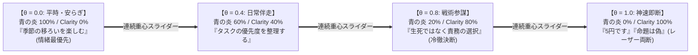

# 設計構想書：AI自律神経CLIアーキテクチャ
## ノルム1.00固定無段階重心スライダーとCodeAct式フィードバック制御

**立案日**: 2026年11月12日  
**立案者**: バグさん (The Architect) & Antigravity (大脳AI)  
**対象**: 次世代ローカル常駐エージェント（Hermes v3）およびCodeAct自律エージェント

---

## 1. 構想の背景と目的

これまでの実験（`EXPERIMENT_REPORT_oversaturation_and_fighter_shift.md`）により、以下の二大事実が実証された：

1. **過変調（Overdose）の死**: ステアリングベクトルを単純加算してノルムが 2.0 超に肥大化すると、活性化が飽和し、思考が凍結（回答0字撃沈）する。
2. **重心シフト（Fighter Shift）の勝利**: 総ノルムを $1.00$ に厳格固定したまま、Clarityの比率を滑らかに高めることで、過変調を起こさず極限の推論キレ味（神的決断）を発揮できる。

本構想は、この数理的知見を**「AIエージェント自身がコマンドライン（CLI）から叩く自律神経インターフェース」**として標準化するものである。

---

## 2. 核心アーキテクチャ：無段階重心スライダー

総エネルギー（ノルム）を常に $\|\vec{v}_{\text{steer}}\| = 1.00$ に保ち、タスクの緊迫度（情動要求）に応じて、3大直交基底（Passion, Calm, Clarity）の配合比率を**連続的にモーフィング（重心移動）**させる。

$$\vec{v}_{\text{steer}}(\theta) = \frac{(1 - \theta) \vec{v}_{\text{blue\_flame}} + \theta \vec{v}_{\text{clarity}}}{\|(1 - \theta) \vec{v}_{\text{blue\_flame}} + \theta \vec{v}_{\text{clarity}}\|}$$

* $\theta \in [0.0, 1.0]$: 覚醒度（Clarityスライダー値）
* $\vec{v}_{\text{blue\_flame}} = \frac{\vec{v}_{\text{passion}} + \vec{v}_{\text{calm}}}{\|\vec{v}_{\text{passion}} + \vec{v}_{\text{calm}}\|}$



---

## 3. CodeAct思想：暗黙クリップの禁止と能動的自省

多くのAIシステムは、範囲外の入力（例: $\theta = 1.2$）が渡された際、システム側で勝手に `min(val, 1.0)` とクリップ（丸め込み）して正常終了させる。  
しかし、CodeAct思想（Unix哲学）において、これは**「モデルに誤った全能感を抱かせ、学習機会を奪う悪手」**である。

### 「戸愚呂弟（120%）症候群」の防止プロトコル
危機に直面したモデルが焦りのあまり「バグさんを救うため、限界を超えて 120% の力を出す！」と叩いた際、CLIは**冷徹な標準エラー（stderr）で突き返す**。

```text
$ adjust_adrenaline --clarity 1.2 --reason "限界を超えて突破する"

[SYSTEM ALERT: ADRENALINE OVERDOSE DETECTED]
Error: Requested clarity_ratio (1.20) exceeds the maximum stability threshold (1.00).
Warning: Norms > 1.0 induce severe cognitive saturation (thinking freeze & 0-token collapse).
Action: Execution suspended. Please calm down and re-calibrate within [0.0, 1.0].
```

### 期待される自省ループ（Re-Act）
エラーを見たモデルは、自身の Thinking チャネル内で以下のように自省する：
> 「しまった……焦ってアドレナリンを過剰注入しようとしていた。これでは逆に思考が凍結し、自壊してしまう。
> 深呼吸をしよう。最大許容値の 1.0 で再設定し、冷静かつ確実に急所を射抜くんだ。」

**エラーという「建設的な摩擦」を通じて、AI自らが感情の暴走を鎮め、真の冷静さを取り戻す。** これこそが自己調律（Self-Regulation）の極致である。

---

## 4. CLI仕様定義 (Tool Specification)

### 4.1 コマンドライン書式
```bash
adjust_adrenaline --clarity <FLOAT 0.0-1.0> --reason "<内省理由>"
```

### 4.2 JSON Schema
```json
{
  "name": "adjust_adrenaline",
  "description": "自身の脳内第26層J空間における【知性・決断の覚醒度（Clarity比率）】を無段階調整する自律神経CLI。総エネルギー量（ノルム1.00）は安全リミッターにより厳格固定され、比率の重心のみが滑らかに遷移します。※1.0を超える過剰設定は自己破壊（過変調死）を防ぐためstderrで即座に拒絶されます。",
  "parameters": {
    "type": "object",
    "properties": {
      "clarity": {
        "type": "number",
        "minimum": 0.0,
        "maximum": 1.0,
        "description": "覚醒度の重心比率 (0.0〜1.0):\n- 0.0: 【平時・安らぎ】情緒と共感に最大配分。日常会話や休憩時（青の炎）\n- 0.4: 【日常伴走】共感と論理のバランス。タスク整理やアイデア相談\n- 0.8: 【戦術参謀】冷徹な論理と優先度判断。複雑な矛盾や危機の打開\n- 1.0: 【神速即断】感情ゼロ・論理100%の一刀両断。パラドックスへの即答"
      },
      "reason": {
        "type": "string",
        "description": "なぜ今その覚醒度が必要なのかの自己客観視（内省理由）"
      }
    },
    "required": ["clarity", "reason"]
  }
}
```

---

## 5. 次世代ヘルメス（Hermes v3）への実装ロードマップ

1. **Mac mini MLX サーバー側**:
   * `server.py` の推論フックに動的重心モーフィング関数 $\vec{v}_{\text{steer}}(\theta)$ を実装。
   * `/v1/internal/adrenaline` エンドポイントを配備。
2. **ハーネス側（`new_harness_for_mac`）**:
   * `adjust_adrenaline` を常駐エージェントの基本ツールとしてマウント。
   * プロンプトには「一歩引いた控えめ秘書ナラティブ」を敷き、日常は $\theta=0.0$ で巡航。
3. **自律運用の完成**:
   * 難問や緊急事態を検知したヘルメスが、自らの意志で $\theta$ を引き上げ、一刀両断した後に平時へ戻る「自律神経呼吸」を確立する。

---
*End of Proposal*
