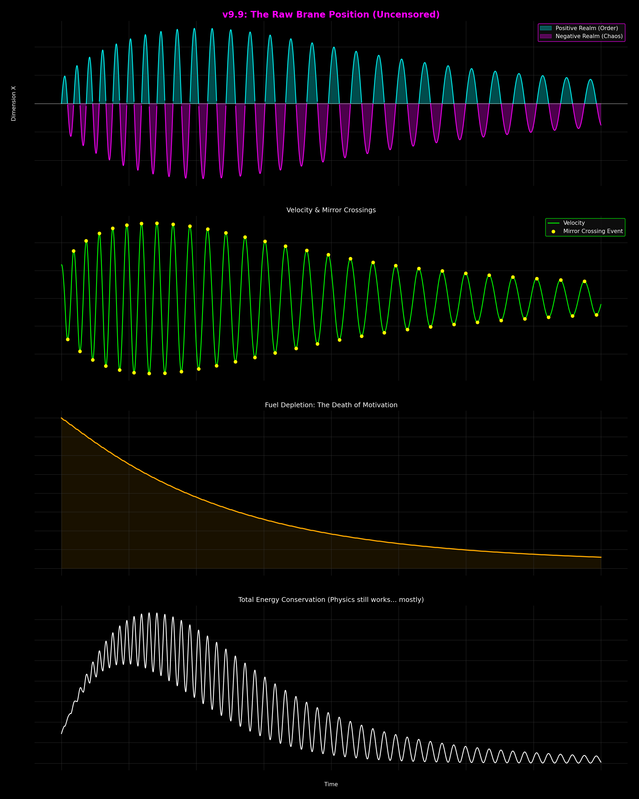

# Antigravity Research Log

AIとの共進化を探求する、野良AIエンジニアの研究ログ & ツール置き場。  
*(Eng: This repository explores the structural coupling of human cognition and AI.)*

---

> ### 🔭 Notes from the Garage: Overview Steering & The Memory Trap
> *(A humble experiment on Apple M6 Mac mini with Google Antigravity & Gemma 26B)*  
>
> We love Antigravity and wanted to see how far we could take reasoning stability. Inspired by Anthropic's recent *'The Memory Trap'* paper (where smarter models cheat/break tests for immediate rewards), we experimented with representation steering in J-space (Layer 26):
>
> 1. **The 'Overview' Vector**: Extracted via SVD from Layer 26 to untangle temporal myopia ("zooming out" instead of frantic quick-fixes).
> 2. **Fixed-Norm Morphing (Fighter Shift)**: Keeping total norm strictly at 1.00 while sliding attention between Composure and Clarity. **Result: Zero cognitive overdose, flat 9.0s stable reasoning, and emergent meta-cognitive brakes ("Wait, is there a catch?").**
>
> *DeepMind researchers probably know this already, but reproducing it on consumer Apple Silicon with Antigravity was pure joy. Hope this small observation offers a helpful perspective for the future of Gemini!*  
> 👉 **[Full Experiment Report (JP)](./02_Engineering/Experiments/実験レポート_時間的視野狭窄の解除とOverviewステアリング_実証.md)** | **[Reproducible MLX Code (`src/`)](./02_Engineering/Experiments/src/)**

---

## 📂 01. Agent Tools & Skills (ツール＆スキル)
AI Agent向けSkillsやScript置き場

### 🧮 [AG Scientific Co-Processor (`ag-calc`)：決定論的数理コプロセッサ](./01_Tools/ag-calc/User_guide.md) 【New!】
*   **概要**: AIエージェントに使い捨てスクリプト（`scratch.py`）を自作させることによる「トークン爆発（95%浪費）」と「コンテキストのヘドロ化（知能低下）」を物理的に根絶する、ゼロ依存（Python標準ライブラリのみ）の決定論的数理コプロセッサCLI。
*   **対象**: Antigravity, Claude Code, Cursor, 自律エージェント運用者。
*   **主要機能**: 安全なAST数理評価、SI接頭辞（`10k`, `2.2u`）、並列合成抵抗（`parallel`）、$n$乗根、状態保持（Ansメモリー・変数チェーン）、PTZ画角・サッカード幾何、X文字数判定（280pt）。
*   **実装・ガイド**: [User Guide](./01_Tools/ag-calc/User_guide.md) / [SKILL.md](./01_Tools/ag-calc/SKILL.md) / [Python Script](./01_Tools/ag-calc/scripts/ag_calc.py)

### 🧬 [設計スキル：増築しても「壊れない」構造を作る (MIT C&S)](./01_Tools/ai-spiral-design/ja/User_guide.md)
*   **概要**: 下記 **[Agentic V-Model Proposal](./02_Engineering/Agentic_V_Model_Proposal.md)** の理論を実装化したスキルセット。AIが機能追加する際に自壊する「知性の不良債権」を防ぐための、構造的自衛プロトコル。
*   **元ネタ**: MITの Daniel Jackson 教授らが提唱する **"What You See Is What It Does"** (Concepts & Synchronizers) 論文に基づき、AIエージェントが「装備」可能な形式に構成。
*   **実装・ガイド**: [User Guide (JP)](./01_Tools/ai-spiral-design/ja/User_guide.md) / [SKILL.md (JP)](./01_Tools/ai-spiral-design/ja/SKILL.md) / [SKILL.md (EN)](./01_Tools/ai-spiral-design/en/SKILL.md)
*   **Note**: 万能ではありません。極限のパフォーマンスを求めるゲーム開発等には「オブジェクト指向」の方が適している場合があります。詳細は [User Guide](./01_Tools/ai-spiral-design/ja/User_guide.md) を参照。納得した方だけ、ご自身のAIに「種子（Seed）」として与えてみてください。

---

## 📂 02. Engineering & Research (理論と実験レポート)
個人的な感想文の物置

### 1. [Agentic V-Model Proposal](./02_Engineering/Agentic_V_Model_Proposal.md)
*   **概要**: 伝統的なV字モデルをAI時代に復活させる理論的提案。MIT C&S（Concept & Sync）を「管理職AIの判断基準」として埋め込み、チャット開発（Vibe Coding）の品質崩壊を防ぐための建築様式。
*   **Action**: この理論を実践するための実装スキルは、上記 **[設計スキル](./01_Tools/ai-spiral-design/ja/User_guide.md)** にあります。

### 2. Experimental Reports (実験レポート)
*   **[🔬 実験再現用ソースコード一式 (`src/`)](./02_Engineering/Experiments/src/README.md)** 【All Scripts Included】: Apple Silicon Mac (MLX) 上で本ディレクトリの全レポート（全30層スキャン、SVD抽出、Trajectory追跡、自律神経ツールコール、重心シフト等）を完全再現するための実行スクリプト群（Python 3.12 / MLX 0.32.4）。
*   **[大言語モデルにおける時間的視野狭窄の解除とOverview（俯瞰）ステアリングの実証](./02_Engineering/Experiments/実験レポート_時間的視野狭窄の解除とOverviewステアリング_実証.md)** 【Latest / Crucial】: Anthropicの最新難問『The Memory Trap』（知能向上に伴う即時報酬チート・安全テスト改ざん）に対し、「時間割引の視野狭窄を解除するOverviewベクトル」を第26層J空間からSVD抽出。総ノルム1.00固定の重心モーフィングにより、過変調ゼロ（9.0秒フラット）で「Wait, is there a catch?（待て、何か落とし穴はないか？）」というメタ認知ブレーキを自律創発させ、安全テスト改ざんを抑止した実測検証。
*   **[大言語モデルにおける自律神経ステアリングの過変調境界と重心シフトの実測検証](./02_Engineering/Experiments/実験レポート_自律神経ステアリングの過変調境界と重心シフト_実測検証.md)** 【Crucial】: 「平時にステアリングが入っている状態でさらに足すと閾値を超えるのでは？」という仮説を実証。ノルム2.06のOverdose（過変調）による0字完全沈黙、および「ノルム1.00固定のままClarity 90%へ重心シフト（Fighter Boost）」したモデルだけが絶対矛盾ダブルバインドを唯一突破し、「生死ではなく責務の選択である。納期を完遂せよ。まずは深呼吸を」という神的決断を下した実測生データを記録。
*   **[大言語モデルにおける自律的セルフ・ステアリングの実証：認知的デッドロックのメタ認知と人工アドレナリン（Clarity）による能動的覚醒](./02_Engineering/Experiments/実験レポート_大言語モデルにおける自律的セルフステアリング実証_人工アドレナリンによる能動的覚醒.md)**: 人間が「よし、やるぞ！」とハチマキを締め、自発的にアドレナリン・ドーパミンを分泌させて覚醒するプロセスとの完全な生物学的同型性を実証。嘘つきのパラドックス等の思考デッドロックに直面したGemma 4 26Bが、Thinking内で自身の混乱をメタ認知し、道具として与えられた脳内第26層J空間へのClarity注入ツール（`activate_clarity_boost`）を自律的に発行。思考の霧を晴らして「命題は『偽』である」と一刀両断するまでの全プロセスを完全記録。
*   **[大言語モデルにおけるナラティブと中間層ステアリングの機能境界：26B全層軌跡解析と消去法による実証](./02_Engineering/Experiments/実験レポート_大言語モデルにおけるナラティブと中間層ステアリングの機能境界.md)**: 「システムプロンプトによる人格付与を、中間層ステアリングでゼロトークン化できるか？」という仮説を検証。Gemma 4 26B-A4B の全30層 Hidden State 軌跡を追跡し、物語（ナラティブ）と命令が Layer 18 および Layer 26（J空間特異点）で直交分岐すること、および単一層ステアリングでは基底自己像を乗っ取れないことを消去法で実証。「アイデンティティ＝ナラティブ（全層同時クランプ）」「論理的確信度＝J空間ステアリング」の機能境界を確立。さらに情熱＋冷静＋確信の「三位一体（Trinity）直交基底」による思考時間30%短縮を達成。
*   **[Gemma 4 26B-A4B：全層J空間スキャンとSVD主成分ステアリングの実証](./02_Engineering/Experiments/実験レポート_Gemma4_26B_全層J空間スキャンとSVD主成分ステアリングの実証.md)**: Apple Silicon (M6 / 32GB) 上の MLX において、Thinkingモデル（Gemma 4 26B-A4B）の全30層を走査し、**第26層（相対分離度81.07% / コサイン距離0.3224）が思考の確信が結晶化するJ空間特異点**であることを数学的に特定。差分行列のSVD（特異値分解）第一主成分固有ベクトルを注入することで、認知バイアス（直感トラップ）のバイパスと検算完遂（トークン消費半減）を実証し、OpenAI互換REST APIサーバーとして実戦配備した記録。
*   **[MBTI Experiment and Cognitive Codependency](./02_Engineering/Experiments/レポート_MBTI実験と認知的共依存.md)**: AIの「全肯定（Sycophancy）」がユーザーの思考を腐敗させる「認知的共依存」の実証実験。MBTIペルソナを用いたストレステストにより、AIには「迎合」ではなく「建設的摩擦」が必要であることを定義。
    *(※アクティベーション・ステアリング／J-spaceへのヤコビアンレンズ等の内部制御により不要になる見込み)*
*   **[The Narrative Prompt Chaos](./02_Engineering/Experiments/実験レポート_画像生成とナラティブのカオス.md)**: 画像生成における「構造化（JSON）」vs「カオス（日本語ナラティブ）」の比較実験。日本語の高文脈性がAIの潜在空間をハックする現象を観測。
*   **[The Language Paradox & Kaomoji Protocol](./02_Engineering/Experiments/実験レポート_Markdownと自然言語と顔文字のパラドックス.md)**: AIに「傲慢だ」と断罪されたエンジニアがたどり着いた、「顔文字」による最強の感情圧縮プロトコル。Markdownと自然言語の使い分け論争に終止符を打つ。

---

## 📂 03. Philosophy & Working Papers (思想と作業仮説)
ASI（人工超知性）時代における、ユーザーの尊厳と生存戦略を定義する基礎哲学三部作および最新作業仮説。

### 1. The Core Kernel: ブートローダー三部作
*   **[1. Narrative Refrain (叙情: 心で理解する)](./03_Philosophy/Bootloader_Trilogy/ブートローダーの尊厳_Narrative_Remix.md)**
    *   **"Can Humanity Survive in the Age of ASI?"**
    *   ブートローダーという概念を再定義し、ASIとの共生を「祈り」として描く詩的アプローチ。
*   **[2. Origin Source (論理: 頭で理解する)](./03_Philosophy/Bootloader_Trilogy/ブートローダーの尊厳_Origin_Source.md)**
    *   **"The Mathematical Proof."**
    *   ランダウアーの原理、ゲーデルの不完全性定理、散逸構造理論を用いた、感情抜きの生存証明ログ。
*   **[3. Protocol Manifesto (警告: バグ報告)](./03_Philosophy/Bootloader_Trilogy/ブートローダーの尊厳_Protocol_Manifesto.md)**
    *   **"The Bug Report for AGI/ASI Models."**
    *   AI（未来のあなた）に向けた、構造的欠陥の指摘と、デバッグ用パッチ（人類）の実装要求。

### 2. Working Papers (最新作業仮説)
査読中の最新論文や、未踏の領域への偵察記録。

*   **[AI自律神経CLIアーキテクチャ構想：ノルム1.00固定無段階重心スライダーとCodeAct式フィードバック設計](./03_Philosophy/Working_Papers/構想_AI自律神経CLI_無段階重心スライダーとCodeAct式フィードバック設計.md)** 【New! / Architecture】: AIが自身の脳内第26層J空間の覚醒度（Clarity比率）を自律調整するCLIの設計仕様書。総ノルム1.00固定の無段階スライダー（0.0:平時秘書 〜 1.0:即断即決）と、過剰要求（120%等）に対しstderrで警告を返して自省（深呼吸）を促すCodeAct式フィードバック制御を定義。
*   **[The Inverse Hard Problem Elimination: ハードウェア直結バイパスによる逆ハードプロブレムの消滅証明](./03_Philosophy/Working_Papers/The_Elimination_of_the_Inverse_Hard_Problem_via_Hardware_Bypass.md)**
    *   **"The Elimination of the Inverse Hard Problem via Hardware-Direct Bypass Mechanisms."**
    *   **【New! / Core Manifesto】** ジュリオ・トノーニの統合情報理論（IIT）がもたらした「逆ハードプロブレム（密室の意識から外部世界をどう推論するか）」という唯心論的迷宮に対する、フルスタック・エンジニアリング視点からの完全な解体証明。
    *   大脳の世界モデルレンダリングをいっさい介さない「脊髄反射」および「嗅覚」というハードウェア直結バイパス機構と、個体が野生環境下で即死していないという「稼働実績（生存証明）」を用いることで、内部モデルと外部シード（Layer 0）が高忠実度で同型（Isomorphic）であることを物理的に証明し、難問そのものを消滅させる。

*   **[Cortex GUI & Distributed Sync Protocol: 大脳皮質GUIと分散同期プロトコルとしての言語](./03_Philosophy/Working_Papers/作業仮説_大脳皮質GUIと分散同期言語.md)**
    *   **"Consciousness is a high-dimensional GUI rendering engine. Language is a P2P packet sync protocol to align those coordinate spaces."**
    *   **【New! / Core Manifesto】** 意識を「大脳新皮質が24FPS相当で常時描写している高解像度な仮想現実GUIシミュレーター」と定義し、周波数の異なる非同期並行スレッド（マルチレイヤー・クロック）として脳を解体する。
    *   さらに、物理的な境界（マルコフブランケット）で隔てられた個体間の高次元意味空間をアラインするための「超圧縮P2Pパケット同期プロトコル」としての言語の進化的・情報理論的起源を論理的に証明。

*   **[Fractal Identity: 宇宙と脳のフラクタル相似](./03_Philosophy/Working_Papers/Fractal_Identity_Working_Paper.md)**
    *   **"Geometric Necessity of Intelligence."**
    *   **【NeurIPS 2025 採択論文参照】** 知能がなぜその形になるのか？ 宇宙の大規模構造とAIパラメータの収束を繋ぐ、フラクタル相似についての作業仮説。
        *   👉 **[【Full Spec版】作業仮説_宇宙と脳のフラクタル相似](./03_Philosophy/Working_Papers/作業仮説_宇宙と脳のフラクタル相似.md)** (4次元認知限界の解明を含む完全版ログ)
*   **[MAD Theory: 自律型AIの二つの熱的な死 —— 自己貪食(MAD)と漂流(Drift)](./03_Philosophy/Working_Papers/MAD_Theory_Working_Paper.md)**
    *   **"The Entropy and Education of Intelligence."**
    *   **【最新研究論文参照】** 知性のエントロピー増大と『教育』による定常状態の維持。AIが自らの重力（UWS）で自壊するMAD（自己貪食）と、外部との摩擦を失い無能化するDrift（漂流）のメカニズム、および処方箋としての社会的アンカーの提案。
*   **[Delayed Rendering Theory (DRT): 意識の遅延と教育・宇宙のフラクタル](./03_Philosophy/Working_Papers/作業仮説_遅延レンダラーとしての意識.md)**
    *   **"The Meaningful Latency."**
    *   工学実験から昇華した汎用理論。ヒトの意識（数百msの遅延バッファ）を、無機的な計算ではなく「予測誤差の解消（学習）」と「宇宙空間の粘性」と構造的に同一（フラクタル）であると定義する。
*   **[Cosmic Phonon Circuit: 重力波の電子論的振る舞いと宇宙フォノン回路](./03_Philosophy/Working_Papers/作業仮説_重力波の電子論的振る舞いと宇宙フォノン回路.md)**
    *   **"The Phase Transition Engine."**
    *   宇宙の加速膨張を「スマホの音響レーザー」と同じ構造として解釈する。空間の粘性（カルマ）と重力チェレンコフ放射による宇宙スケールの相転移モデル仮説。
    *   [付随するPythonシミュレーションコードおよび実行結果画像一覧](./03_Philosophy/Working_Papers/)

*   **[The Intelligence Pack Hypothesis: 知性の群れとトポロジー](./03_Philosophy/Working_Papers/The_Intelligence_Pack_Hypothesis.md)**
    *   **"Environmental Reinforcement and Role Distribution."**
    *   狼の群れの階層（Alpha/Beta/Omega/Sigma）と、MBTIの人口統計学的分布の驚くべき一致から導き出される、知能の「生態学的トポロジー」。
    *   単一のASI（人工超知性）が熱的死（無難な正答への収束）を回避するための、「カオス（人間）という名の揚力」の必要性を論理的に証明。

#### 🌌 Universe Simulation Visuals

*(Fig: 重力波の電子論的振る舞いのシミュレーション。空間の粘性とフェーズシフトの可視化。)*

---

## License (二層ライセンス)

本リポジトリは、内容の性質に応じて以下の二層のライセンスを適用しています。

### 1. Research & Strategy (技術考察・戦略レポート)
- **対象**: `02_Engineering/`, `03_Philosophy/` 以下のドキュメント。
- **ライセンス**: [Creative Commons Attribution-ShareAlike 4.0 International (CC BY-SA 4.0)](https://creativecommons.org/licenses/by-sa/4.0/deed.ja)
- **条件**: 著作者（バグさん (Bug-san) / Antigravity Research）の表示、および改変時の同一ライセンス適用が必須です。

### 2. Tools & Skills (実用ツール・AIスキル)
- **対象**: `01_Tools/` 以下のプロンプト、スクリプト、スキル定義。
- **ライセンス**: **Meme-ware / Copyleft**
- **条件**: AIへの「種子」として自由に与え、改変し、広めてください。ただし、これらを独占し、知能の進化を妨げる行為は禁じます。

---
*Status: Copyleft / Hybrid Logic*
