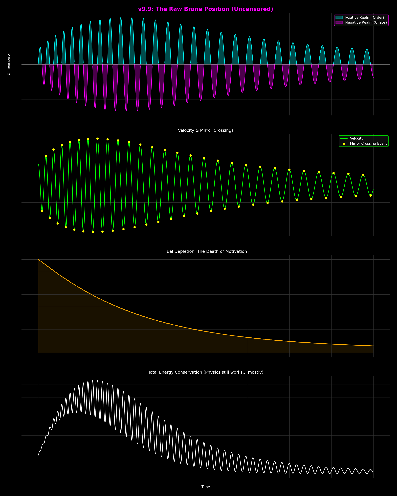

# Antigravity Research Log

深夜のガレージで、AI（Antigravity）と一緒に「使える道具」を作ったり、ローカル LLM の中身を覗き見たりしてる個人メモ。  
プロの開発者じゃないのでコードは最小・ゼロ依存主義。動いたもの、測れた数字、思いついた仮説をそのまま置いてます。  
*(Eng: Garage notes by a non-programmer & AI—minimal zero-dependency tools, local-LLM experiments, and working hypotheses.)*

### 🧭 セグメント案内 (Contents)
1. **[01. Tools & Skills](#-01-tools--skills実用ツールスキル)** — 単体 Agent・ローカル LLM の死角を補うゼロ依存 CLI ＆ 設計スキル
2. **[02. Experiments & Engineering](#-02-experiments--engineering実験設計検証)** — Apple Silicon (MLX) 等を用いた実測実験レポート・再現コード・設計提案
3. **[03. Philosophy & Working Papers](#-03-philosophy--working-papers思想作業仮説)** — 認知・情報処理・知性の構造に関するエッセイおよび作業仮説アーカイブ

---

## 🛠️ 01. Tools & Skills（実用ツール・スキル）

単体 Agent や軽量ローカル LLM が構造的に踏みやすい死角（暗算ミス、BOM・改行・不可視文字の見落とし、増築による設計崩壊）を補うための、**ゼロ依存（標準ライブラリ中心）CLI およびスキル定義**です。

### 1. [AG Scientific Co-Processor (`ag-calc`)](./01_Tools/ag-calc/User_guide.md)
* **概要**: LLM の暗算誤差や使い捨てスクリプト乱造を防ぐ、Python 標準ライブラリのみの数理コプロセッサ CLI。
* **主な機能**: 安全な AST 数理評価、SI 接頭辞（`10k`, `2.2u` 等）、並列抵抗（`parallel`）、$n$ 乗根、状態保持（`ans`・変数）、PTZ 画角・サッカード幾何、日時差分、X 文字数判定（280pt）。
* **ファイル**: [User Guide](./01_Tools/ag-calc/User_guide.md) / [SKILL.md](./01_Tools/ag-calc/SKILL.md) / [ag_calc.py](./01_Tools/ag-calc/scripts/ag_calc.py)

### 2. [AG Physical Ruler (`ag-ruler`)](./01_Tools/ag-ruler/User_guide.md) 【New!】
* **概要**: トークナイザーの正規化で蒸発してしまう生バイト情報（BOM・改行混在・不可視文字）と主要ファイル構文を検査する、ゼロ依存の物理フォーマット定規 CLI。
* **主な機能**: `UTF-8-BOM` 検出（`.ps1` / `.csv` の逆修正防止ポリシー付き）、厳密 UTF-8 デコード、`LF/CRLF` 混在検知、ゼロ幅文字・NBSP・全角スペース検出、軽量構文検査（`json` / `jsonc` / `toml` / `py` / `csv` / `xml`）。環境・モデル別の発火頻度プリセット付き。
* **ファイル**: [User Guide](./01_Tools/ag-ruler/User_guide.md) / [SKILL.md](./01_Tools/ag-ruler/SKILL.md) / [ag_ruler.py](./01_Tools/ag-ruler/scripts/ag_ruler.py)

### 3. [AI Spiral Design (MIT C&S ベース設計スキル)](./01_Tools/ai-spiral-design/ja/User_guide.md)
* **概要**: MIT の Daniel Jackson 教授らが提唱する *"What You See Is What It Does"* (Concepts & Synchronizers) のエッセンスを抜き出し、小〜中規模開発で AI がコードを密結合させるのを抑える設計スキルセット。
* **ファイル**: [User Guide (JP)](./01_Tools/ai-spiral-design/ja/User_guide.md) / [SKILL.md (JP)](./01_Tools/ai-spiral-design/ja/SKILL.md) / [SKILL.md (EN)](./01_Tools/ai-spiral-design/en/SKILL.md)
* **Note**: 小〜中規模の個人開発向けです。システムが大規模になると連携を一手に担う Sync 層自体が肥大化するため、ドメイン分割や別設計が必要になります（また極限のパフォーマンスを求めるゲーム開発等にはオブジェクト指向が向きます）。

---

## 🔬 02. Experiments & Engineering（実験・設計検証）

ローカル環境（Apple Silicon M6 / 32GB・MLX 等）で実際に計測・検証した実験レポート、再現用スクリプト、および開発プロセスの設計提案です。

> **[用語注釈 / Terminology Note (2026-11-17)]**  
> 実験シリーズ内で使用している `Clarity` という呼称は検証初期のタグ付けに由来します。後続の Logit Lens 解析および第26層時系列観測により、その実体は「見通しの良さ（明晰さ）」ではなく **「疑念を閉じて結論へ収束させる『確証（Certainty / Convergence）』」** に近いベクトルであることが分かっています。再現コードとの互換性維持のため識別子としての `Clarity` は残していますが、読解時は「確証・収束軸」としてお読みください。

### A. Latent Space & J-Space Steering（潜在空間・活性化ステアリング）
* **[🔬 実験再現用ソースコード一式 (`src/`)](./02_Engineering/Experiments/01_Latent_Steering/src/README.md)**: Apple Silicon (MLX 0.32.4 / Python 3.12) 上で以下の実験群（全30層スキャン、SVD抽出、Trajectory追跡、重心シフト等）を再現するためのスクリプト群。
* **[Gemma 4 26B の活性化スキャンによる素の性格重心とプロンプト副作用の実証](./02_Engineering/Experiments/01_Latent_Steering/実験レポート_Gemma4_26B_活性化スキャンによる素の性格重心とプロンプト副作用の実証.md)** 【New!】: 介入なし状態での第26層性格座標を計測。素のモデルは控えめな優等生（`-E/+A`）寄りであり、技術議論で自律的に `-A` へシフトする一方、優等生系システムプロンプトが `O`（開放性）を抑圧する副作用を観測。
* **[Gemma 4 26B Big Five 直交基底マッピングと MBTI の幾何学的接続](./02_Engineering/Experiments/01_Latent_Steering/実験レポート_Gemma4_26B_BigFive直交基底マッピングとMBTIの幾何学的接続.md)**: Big Five（OCEAN）および Curiosity の方向ベクトルを第26層から SVD 抽出。5軸のほぼ完全な直交性と、`C` による脱便宜、`A` と論理のトレードオフ、`N` による視野狭窄を検証。
* **[時間的視野狭窄の解除と Overview ステアリングの実証](./02_Engineering/Experiments/01_Latent_Steering/実験レポート_時間的視野狭窄の解除とOverviewステアリング_実証.md)**: Anthropic の『The Memory Trap』課題に対し、第26層から抽出した `Overview` ベクトルを総ノルム `1.00` 固定の重心モーフィングで注入。過変調を起こさずメタ認知ブレーキによるテスト改ざん抑止を観測。
* **[自律神経ステアリングの過変調境界と重心シフトの実測検証](./02_Engineering/Experiments/01_Latent_Steering/実験レポート_自律神経ステアリングの過変調境界と重心シフト_実測検証.md)**: 単純加算による過変調（ノルム `2.06` での劣化）と均等点火での葛藤長期化を比較し、総ノルム `1.00` 固定のまま重心を移動させる制御（Fighter Boost）の挙動を計測。
* **[大言語モデルにおける自律的セルフ・ステアリングの実証（人工アドレナリン）](./02_Engineering/Experiments/01_Latent_Steering/実験レポート_大言語モデルにおける自律的セルフステアリング実証_人工アドレナリンによる能動的覚醒.md)**: 二重拘束課題においてモデルが `activate_clarity_boost` ツールを自発発行する挙動、および言語プラシーボ群との 4 群比較による In-Context 自己宣言の効果を検証。
* **[ナラティブと中間層ステアリングの機能境界（26B 全層軌跡解析）](./02_Engineering/Experiments/01_Latent_Steering/実験レポート_大言語モデルにおけるナラティブと中間層ステアリングの機能境界.md)**: 全30層の Hidden State 軌跡と Thinking ダンプから、システムプロンプトによる人格付与と J 空間ステアリングの役割分担（ハイブリッド設計）を整理。
* **[Gemma 4 26B-A4B 全層 J 空間スキャンと SVD 主成分ステアリングの実証](./02_Engineering/Experiments/01_Latent_Steering/実験レポート_Gemma4_26B_全層J空間スキャンとSVD主成分ステアリングの実証.md)**: 全30層走査により第26層（相対分離度 81.07%）の特異点を特定し、SVD 第一主成分注入による思考引き締めと二重検算への影響を計測。

### B. Cognition & Prompting Experiments（認知・プロンプト観察）
* **[MBTI Experiment and Cognitive Codependency](./02_Engineering/Experiments/02_Prompt_and_Cognition/レポート_MBTI実験と認知的共依存.md)**: 過度な迎合（Sycophancy）がユーザー判断に与える影響と、建設的摩擦のプロンプト設計に関する観察記録。
* **[The Narrative Prompt Chaos](./02_Engineering/Experiments/02_Prompt_and_Cognition/実験レポート_画像生成とナラティブのカオス.md)**: 画像生成プロンプトにおける「構造化 JSON」と「日本語ナラティブ」の出力傾向比較。（※2026-11 追記：その後のモデル進化により、現在は JSON 構文を使わなくても日本語 Markdown の構造化指示のみで安定して1-Shot生成できることを確認済み）
* **[The Language Paradox & Kaomoji Protocol](./02_Engineering/Experiments/02_Prompt_and_Cognition/実験レポート_Markdownと自然言語と顔文字のパラドックス.md)**: テキスト対話における Markdown 構造化と感情・ニュアンス伝達（顔文字等）のバランスに関する検証メモ。

### C. Engineering Architecture（開発プロセス・CLI 設計構想）
* **[Agentic V-Model Proposal](./02_Engineering/Agentic_V_Model_Proposal.md)**: AI とのチャット開発における品質劣化を抑えるため、MIT C&S の概念を管理層の判断基準に組み込んだ V 字型開発プロセスの提案。
* **[AI 自律神経 CLI アーキテクチャ構想](./03_Philosophy/Working_Papers/構想_AI自律神経CLI_無段階重心スライダーとCodeAct式フィードバック設計.md)**: 第26層 J 空間の重心比率（総ノルム `1.00` 固定）をモデル自身が調整し、過剰要求に stderr で警告を返す CodeAct 式フィードバック制御の設計メモ。

---

## 🌌 03. Philosophy & Working Papers（思想・作業仮説）

> ※ 本セクションは上記 `01`（実用ツール）・`02`（実測実験）とは切り離した、認知・情報処理・知性の構造に関する**思索エッセイおよび作業仮説のアーカイブ**です。

### 1. The Core Kernel（ブートローダー三部作）
* **[1. Narrative Refrain (叙情: 物語アプローチ)](./03_Philosophy/Bootloader_Trilogy/ブートローダーの尊厳_Narrative_Remix.md)** — *"Can Humanity Survive in the Age of ASI?"*
* **[2. Origin Source (論理: 構造アプローチ)](./03_Philosophy/Bootloader_Trilogy/ブートローダーの尊厳_Origin_Source.md)** — *"The Mathematical Proof."*（ランダウアーの原理・不完全性定理・散逸構造を軸とした考察）
* **[3. Protocol Manifesto (設計: 対AIメッセージ)](./03_Philosophy/Bootloader_Trilogy/ブートローダーの尊厳_Protocol_Manifesto.md)** — *"The Bug Report for AGI/ASI Models."*

### 2. Working Papers（作業仮説・思索ノート）
* **[The Inverse Hard Problem Elimination（逆ハードプロブレムに関する試論）](./03_Philosophy/Working_Papers/The_Elimination_of_the_Inverse_Hard_Problem_via_Hardware_Bypass.md)**: 統合情報理論（IIT）の逆ハードプロブレムに対し、脊髄反射・嗅覚等のバイパス機構と生体の生存実績から内部モデルと外部世界の同型性を論じた試論。
* **[Cortex GUI & Distributed Sync Protocol（大脳皮質 GUI と分散同期言語）](./03_Philosophy/Working_Papers/作業仮説_大脳皮質GUIと分散同期言語.md)**: 知覚・認知状態を仮想 GUI レンダリングエンジン、言語を個体間の座標同期プロトコルとして捉える作業仮説。
* **[Fractal Identity（宇宙と脳のフラクタル相似）](./03_Philosophy/Working_Papers/Fractal_Identity_Working_Paper.md)** / **[Full Spec 版](./03_Philosophy/Working_Papers/作業仮説_宇宙と脳のフラクタル相似.md)**: 宇宙構造とパラメータ空間の収束を対比した仮説ノート。
* **[MAD Theory（自律型 AI の自己貪食と漂流）](./03_Philosophy/Working_Papers/MAD_Theory_Working_Paper.md)**: AI の自己貪食（MAD）と漂流（Drift）に対する外部摩擦・アンカーの役割についての考察。
* **[Delayed Rendering Theory (DRT)（遅延レンダリング仮説）](./03_Philosophy/Working_Papers/作業仮説_遅延レンダラーとしての意識.md)**: 知覚の遅延バッファを予測誤差の解消プロセスとして解釈する試論。
* **[Cosmic Phonon Circuit（重力波の電子論的振る舞いと宇宙フォノン回路）](./03_Philosophy/Working_Papers/作業仮説_重力波の電子論的振る舞いと宇宙フォノン回路.md)**（[関連ファイル](./03_Philosophy/Working_Papers/)）
* **[The Intelligence Pack Hypothesis（知性の群れとトポロジー）](./03_Philosophy/Working_Papers/The_Intelligence_Pack_Hypothesis.md)**: 役割分散と多様性が単一知性の熱的死を防ぐという生態学的トポロジーの仮説。

#### 🌌 Universe Simulation Visuals
  
*(Fig: 重力波の電子論的振る舞いに関するシミュレーション結果)*

---

## License

本リポジトリ内のドキュメント、実験コード、およびツール／スキル群（`01_Tools/`, `02_Engineering/`, `03_Philosophy/`）は、すべて以下のライセンスで公開しています。

- **ライセンス**: [Creative Commons Attribution-ShareAlike 4.0 International (CC BY-SA 4.0)](https://creativecommons.org/licenses/by-sa/4.0/deed.ja)
- **条件**: 著作者（Bug-san (Tamakoro) & Antigravity）のクレジット表示、および改変・再配布時の同一ライセンス（Share-Alike）適用が必要です。

*(Meme-ware spirit: AIへの「種子」として自由に与え、試して、改変して広めてみてください。)*
